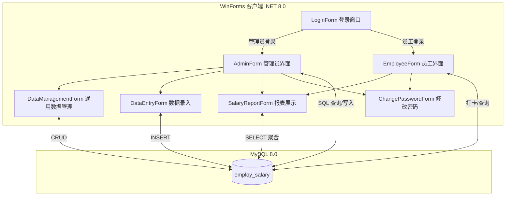
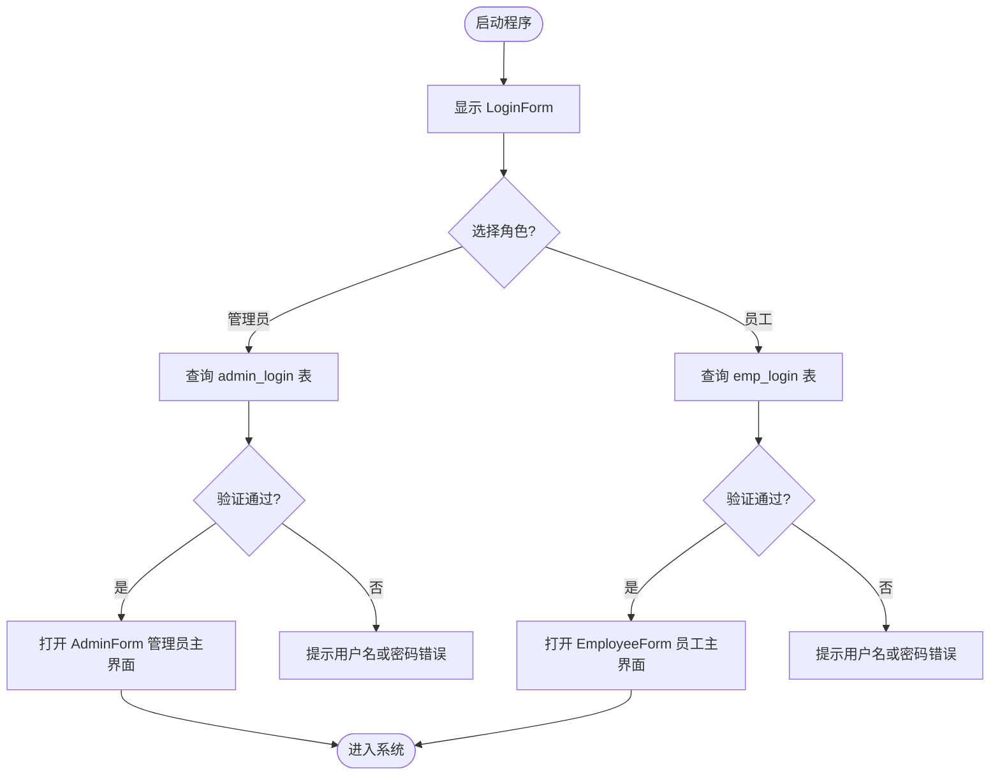
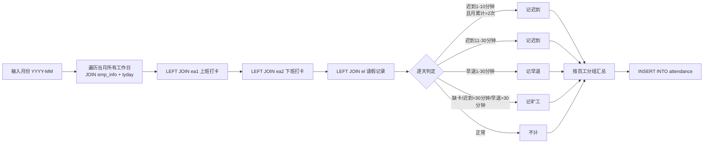
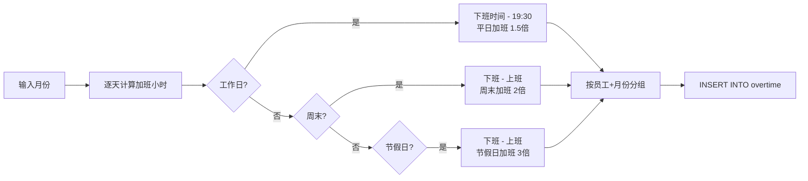
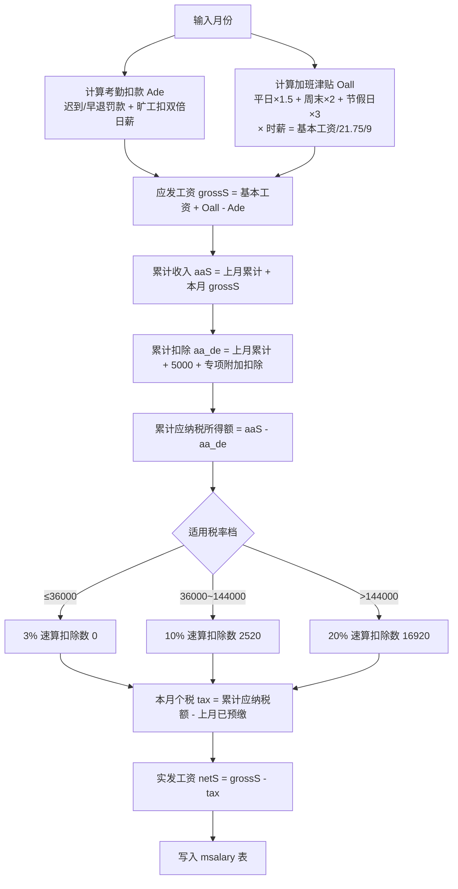

# 员工工资管理系统 (Employee Salary Management System)

基于 **C# WinForms (.NET 8.0)** + **MySQL 8.0** 的桌面端员工工资管理系统，为数据库课程设计项目。系统实现了从打卡考勤、加班统计、薪资计算到个税累计预扣的完整业务闭环。

---

## 目录

- [系统架构](#系统架构)
- [功能模块](#功能模块)
- [数据库设计](#数据库设计)
- [核心业务流程](#核心业务流程)
- [薪资计算规则](#薪资计算规则)
- [快速开始](#快速开始)
- [注意事项](#注意事项)
- [默认账号](#默认账号)
- [项目结构](#项目结构)

---

## 系统架构

系统采用经典的两层 C/S 架构：WinForms 客户端直接通过 MySql.Data Connector 连接 MySQL 数据库，所有业务逻辑（考勤统计、加班折算、薪资计算、个税累计预扣）均通过内嵌 SQL 语句在数据库端完成计算，客户端仅负责界面交互与数据展示。



### 登录与角色分流流程



---

## 功能模块

### 管理员端

| 模块 | 功能 |
|------|------|
| 基础信息管理 | 部门信息增删改查、员工信息管理、工种薪资规则配置 |
| 考勤加班管理 | 员工请假登记、月度考勤自动统计（迟到/早退/旷工）、月度加班自动统计（平日/周末/节假日）、月度薪资一键计算 |
| 年度查询 | 按部门查年度薪资汇总、按员工查年度薪资明细、生成年终奖金 |
| 报表输出 | 月度企业工资报表、年度企业工资报表 |
| 系统操作 | 修改密码、退出登录 |

### 员工端

| 功能 | 说明 |
|------|------|
| 上班打卡 | 写入 ea1 表，记录打卡时间 |
| 下班打卡 | 写入 ea2 表，记录打卡时间 |
| 年度薪资查询 | 查看本人全年各月实发工资明细 |
| 年终奖金查询 | 查看本人年终奖金额 |
| 修改密码 | 修改 emp_login 表中的密码 |

---

## 数据库设计

数据库 `employ_salary` 共 13 张表，按业务域分为四类：登录认证、基础信息、考勤打卡、薪资核算。

### ER 关系图

```mermaid
erDiagram
    dept_info ||--o{ emp_info : "管辖"
    emp_info ||--|| jobtype_rule : "按工种+等级匹配"
    admin_login {
        string admin_id PK
        string admin_pass
    }
    dept_info {
        string Dno PK
        string Dname
        string Eno FK
    }
    emp_info {
        string Eno PK
        string Ename
        string Esex
        date Ebirth
        string Etitle
        string Egrade
        string Dno FK
        date Ehire_date
        decimal Ede
    }
    jobtype_rule {
        string Etitle
        string Egrade
        decimal baseS
    }
    emp_login {
        string Eno PK FK
        string Epass
    }
    ea1 {
        string Eno PK FK
        datetime Atime1 PK
    }
    ea2 {
        string Eno PK FK
        datetime Atime2 PK
    }
    el {
        string Eno PK FK
        date Ldate PK
    }
    attendance {
        string Eno PK FK
        string Amonth PK
        int late
        int early
        int absent
    }
    overtime {
        string Eno PK FK
        string Omonth PK
        decimal wdhour
        decimal wehour
        decimal hlhour
    }
    msalary {
        string Eno PK FK
        string Smonth PK
        decimal baseS
        decimal Oall
        decimal Ade
        decimal grossS
        decimal aaS
        decimal aa_de
        decimal tax
        decimal netS
        decimal aa_tax
    }
    bonus {
        string Eno PK FK
        string Byear PK
        decimal bonus
    }
    tyday {
        date date_thisyear PK
        tinyint is_workday
        tinyint is_weekend
        tinyint is_holiday
    }

    emp_info ||--o{ emp_login : "拥有"
    emp_info ||--o{ ea1 : "打卡"
    emp_info ||--o{ ea2 : "打卡"
    emp_info ||--o{ el : "请假"
    emp_info ||--o{ attendance : "月度统计"
    emp_info ||--o{ overtime : "月度统计"
    emp_info ||--o{ msalary : "月度薪资"
    emp_info ||--o{ bonus : "年终奖"
    tyday ||--o{ attendance : "按工作日计算"
```

### 表说明

| 表名 | 中文名 | 说明 |
|------|--------|------|
| `admin_login` | 管理员登录表 | 存储管理员账号密码 |
| `emp_login` | 员工登录表 | 存储员工登录密码，与 emp_info 一对一 |
| `dept_info` | 部门信息表 | 部门编号、名称、负责人 |
| `emp_info` | 员工信息表 | 员工基本信息，含专项附加扣除额 |
| `jobtype_rule` | 工种薪资规则表 | 按工种+等级定义基本工资 |
| `ea1` | 上班打卡记录表 | 每日上班打卡时间，主键为工号+日期时间 |
| `ea2` | 下班打卡记录表 | 每日下班打卡时间 |
| `el` | 请假记录表 | 员工请假日期 |
| `attendance` | 月度考勤统计表 | 按月汇总每人迟到/早退/旷工次数 |
| `overtime` | 月度加班统计表 | 按月汇总平日/周末/节假日加班小时数 |
| `msalary` | 月度薪资表 | 核心表，含基本工资、加班津贴、考勤扣款、应发、累计个税、实发 |
| `bonus` | 年终奖金表 | 每人每年年终奖金额 |
| `tyday` | 日历表 | 2025 年全年 365 天，标记工作日/周末/节假日 |

---

## 核心业务流程

### 月度考勤统计流程

管理员输入月份后，系统执行一段复杂的嵌套 SQL：以 `emp_info` 为基表，关联 `tyday` 当月所有工作日，再 LEFT JOIN 当日上班/下班打卡记录和请假记录，逐天判定是否迟到、早退、旷工，最后按员工分组汇总写入 `attendance` 表。



### 月度加班统计流程

以打卡时间为基准：工作日 19:30 之后下班算平日加班；周末/节假日全天有打卡则按实际工时计算加班小时。



### 月度薪资计算与个税累计预扣流程

这是系统最核心的业务逻辑，全部通过 MySQL CTE（公用表表达式）在一条 SQL 中完成。



---

## 薪资计算规则

| 项目 | 计算方式 |
|------|----------|
| **基本工资** | 按员工工种（Etitle）+ 等级（Egrade）查 `jobtype_rule.baseS` |
| **加班津贴** | 平日加班时薪 × 1.5 + 周末加班时薪 × 2 + 节假日加班时薪 × 3；时薪 = 基本工资 / 21.75 / 9 |
| **考勤扣款** | 迟到/早退 1-10 分钟：前 2 次每次扣 10 元，超出后每次扣 30 元；旷工每次扣双倍日工资（基本工资 / 21.75 × 2） |
| **应发工资** | 基本工资 + 加班津贴 - 考勤扣款 |
| **个人所得税** | 按累计预扣法：累计应纳税所得额 = 累计收入 - 累计基本减除费用（5000/月）- 累计专项附加扣除；适用 3% / 10% / 20% 三档超额累进税率 |
| **实发工资** | 应发工资 - 当月个税 |
| **年终奖金** | 年度累计应发工资 / 12 |

---

## 快速开始

### 1. 环境要求

- Windows 操作系统
- .NET 8.0 SDK
- MySQL 8.0（本地运行）
- Visual Studio 2022（推荐）或 Rider

### 2. 数据库准备

```sql
-- 创建数据库
CREATE DATABASE employ_salary DEFAULT CHARACTER SET utf8 COLLATE utf8_general_ci;
USE employ_salary;

-- 按以下顺序执行 database/ 目录下的 SQL 文件（外键依赖顺序）
source database/dept_info.sql;
source database/emp_info.sql;
source database/jobtype_rule.sql;
source database/admin_login.sql;
source database/emp_login.sql;
source database/ea1.sql;
source database/ea2.sql;
source database/el.sql;
source database/attendance.sql;
source database/overtime.sql;
source database/msalary.sql;
source database/bonus.sql;
source database/tyday.sql;
```

### 3. 修改数据库连接密码

> **重要：运行前必须替换密码！**

代码中所有 MySQL 连接字符串的密码均已脱敏为 `YOUR_PASSWORD`，需替换为你本机 MySQL 的 root 密码。涉及以下文件（共约 10 处）：

- `Esalary/LoginForm.cs`
- `Esalary/AdminForm.cs`
- `Esalary/ChangePasswordForm.cs`
- `Esalary/DataEntryForm.cs`
- `Esalary/DataManagementForm.cs`
- `Esalary/EmployeeForm.cs`
- `Esalary/SalaryReportForm.cs`

在 Visual Studio 中按 `Ctrl + Shift + F` 全局搜索 `YOUR_PASSWORD`，一键替换为你的密码即可：

```csharp
// 修改前
private string connectionString = "Server=localhost;Database=employ_salary;Uid=root;Pwd=YOUR_PASSWORD;";

// 修改后（示例）
private string connectionString = "Server=localhost;Database=employ_salary;Uid=root;Pwd=你的实际密码;";
```

### 4. 配置 MySql.Data 引用

> **注意：csproj 中的 MySql.Data.dll 路径为本机绝对路径，换电脑后需要调整。**

`Esalary.csproj` 中 MySql.Data 的 HintPath 指向作者本机的 MySQL Connector 安装路径：

```xml
<HintPath>..\..\..\..\..\..\Program Files (x86)\MySQL\Connector NET 8.0\Assemblies\v4.8\MySql.Data.dll</HintPath>
```

**解决方式（二选一）：**

1. **推荐方式 — 通过 NuGet 安装**：在 Visual Studio 中右键项目 → 管理 NuGet 包 → 搜索 `MySql.Data` → 安装最新稳定版，然后移除 csproj 中的旧 HintPath 引用。
2. **手动方式**：如果本机已安装 MySQL Connector/NET 8.0，将 HintPath 修改为你本机对应的 `MySql.Data.dll` 路径。

### 5. 运行

使用 Visual Studio 2022 打开 `Esalary.sln`，还原 NuGet 包后按 `F5` 运行。

---

## 注意事项

1. **密码安全**：本项目为课程设计作品，原始代码中硬编码了数据库密码，已在上传前脱敏为 `YOUR_PASSWORD`。请不要将包含真实密码的代码提交到公开仓库。
2. **打卡时间基准**：系统默认上班时间为 09:00，迟到判定阈值为 09:30；下班时间为 18:00，早退判定阈值为 18:30。如需调整，修改 `AdminForm.cs` 中 `ExecuteAttendanceSql` 方法内的 SQL 即可。
3. **个税税率**：当前实现仅覆盖 3%、10%、20% 三档（对应年应纳税所得额 14.4 万以内），如需更高档位（25%、30%、35%、45%）需扩展 `ExecuteMonthlySalaryInsertSql` 中的 CASE WHEN 逻辑。
4. **日历表**：`tyday.sql` 仅包含 2025 年的日历数据，如需其他年份需自行补充。
5. **课程设计报告**：`数据库课程设计A报告.docx` 为 Word 二进制文件，未包含在 Git 仓库中，可向作者索取。

---

## 默认账号

| 角色 | 用户名 | 密码 |
|------|--------|------|
| 管理员 | admin | 666 |
| 管理员 | wym | 123456 |
| 员工 | E1234567 | 123456 |
| 员工 | E2023001 | 123 |
| 员工 | E2345678 | 123456 |
| 员工 | E3456789 | 123456 |

---

## 项目结构

```
Employee-Salary-Management-System/
├── Esalary.sln                  # Visual Studio 解决方案
├── README.md                    # 项目说明（本文件）
├── .gitignore                   # Git 忽略规则
├── Esalary/                     # WinForms 项目
│   ├── Esalary.csproj           # 项目文件（含 MySql.Data 引用）
│   ├── Program.cs               # 程序入口
│   ├── LoginForm.cs             # 登录窗口（管理员/员工双角色）
│   ├── AdminForm.cs             # 管理员主界面（含考勤/加班/薪资核心SQL）
│   ├── EmployeeForm.cs          # 员工主界面（打卡/查询）
│   ├── DataManagementForm.cs    # 通用 DataGridView 数据管理（增删改查）
│   ├── DataEntryForm.cs          # 通用数据录入表单
│   ├── InputForm.cs             # 通用单行输入弹窗
│   ├── ChangePasswordForm.cs     # 修改密码
│   └── SalaryReportForm.cs      # 薪资报表展示
└── database/                     # MySQL 建表脚本与测试数据
    ├── admin_login.sql           # 管理员登录表
    ├── emp_login.sql             # 员工登录表
    ├── emp_info.sql              # 员工信息表
    ├── dept_info.sql             # 部门信息表
    ├── jobtype_rule.sql         # 工种薪资规则表
    ├── ea1.sql                   # 上班打卡记录表
    ├── ea2.sql                   # 下班打卡记录表
    ├── el.sql                    # 请假记录表
    ├── attendance.sql            # 月度考勤统计表
    ├── overtime.sql              # 月度加班统计表
    ├── msalary.sql               # 月度薪资表（含累计个税）
    ├── bonus.sql                 # 年终奖金表
    └── tyday.sql                 # 2025年日历表（工作日/周末/节假日）
```

---

## License

仅用于学习交流，请勿用于商业用途。
